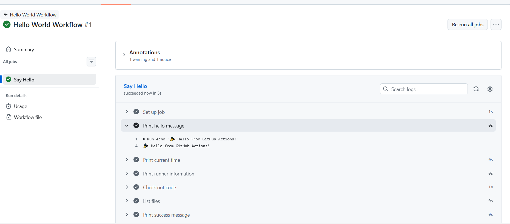
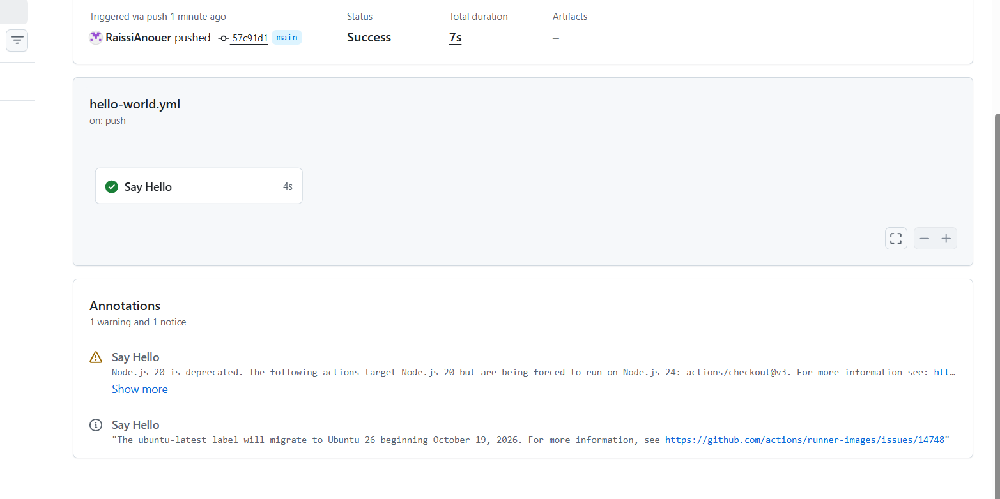
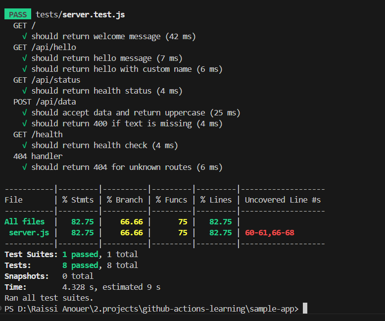
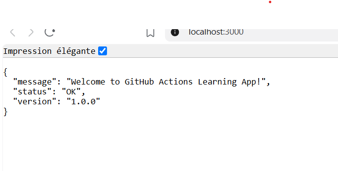
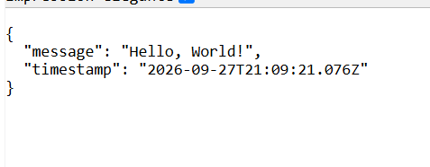
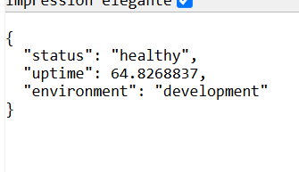

# Beginner Badge Submission - Raissi Anouer

**Date:** January 2026
**Status:** Submitted for Review

## Tasks Completed

- [x] Task 1: Run Your First Workflow
- [x] Task 2: Understand Workflow Triggers
- [x] Task 3: Build and Test Locally

## Evidence

### Task 1: Hello World Workflow

### Task 2: Push Trigger

### Task 3: Local Tests

#### Server and API Verification

## Notes
Completed all three beginner tasks: workflow manual dispatch, push event triggers, and local testing and verification.
