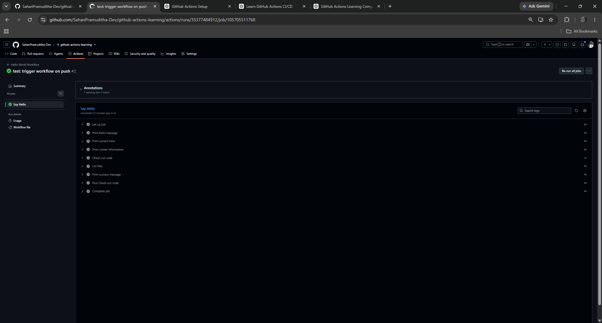
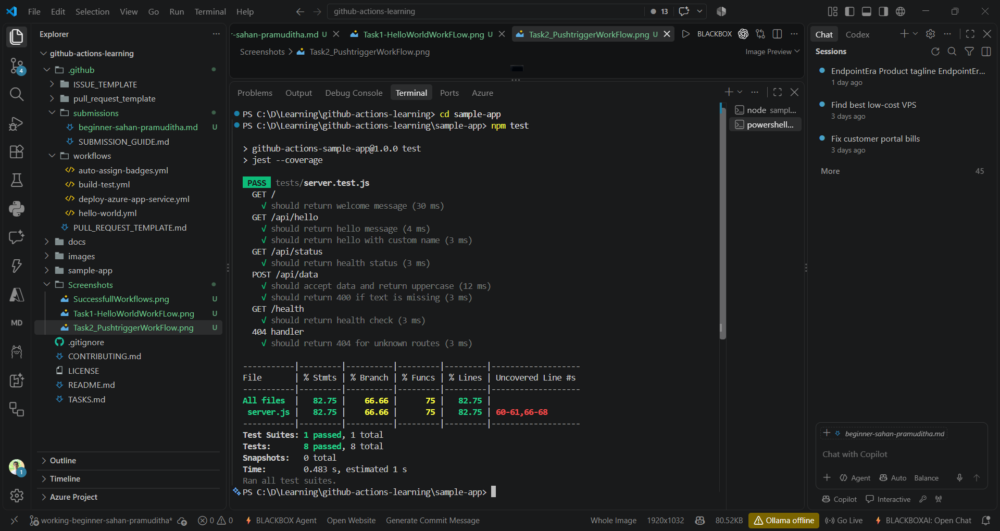

# 🌟 Beginner Badge Submission — Sahan Pramuditha

**GitHub Username:** @SahanPramuditha-Dev  
**Level:** Beginner  
**Status:** Ready for Review

## Tasks Completed

- [x] Task 1: Run Your First Workflow
- [x] Task 2: Understand Workflow Triggers
- [x] Task 3: Build and Test Locally

---

## Task 1 — Run Your First Workflow

For my first task, I ran the `Hello World Workflow` manually using the
`workflow_dispatch` event. It finished successfully, and each step completed
without errors.

### Evidence

**Workflow Run:**  
https://github.com/SahanPramuditha-Dev/github-actions-learning/actions/runs/35377103262


### What I Learned

- I learned how to start a GitHub Actions workflow manually with
  `workflow_dispatch`.
- I practiced opening a workflow run and checking its jobs and steps.
- I learned how to read the logs produced by a GitHub-hosted runner.

---

## Task 2 — Understand Workflow Triggers

Next, I made a small change to `.github/workflows/hello-world.yml`, committed
it, and pushed the commit to the `main` branch.

This time, I did not start the workflow myself. GitHub Actions detected the
push and started the workflow automatically because the workflow listens for
`push` events on `main`.

### Evidence

**Workflow Run:**  
https://github.com/SahanPramuditha-Dev/github-actions-learning/actions/runs/35377484912

**Commit:**

```text
52c8f31 - test: trigger workflow on push
```



### What I Learned

- I learned the difference between a manual `workflow_dispatch` trigger and an
  automatic `push` trigger.
- I saw how branch filters determine which pushes should start a workflow.
- I also saw how a normal code push can begin a CI run automatically.

---

## Task 3 — Build and Test Locally

For the final task, I opened the sample application and installed its
dependencies:

```bash
cd sample-app
npm install
```

After that, I ran the automated test suite:

```bash
npm test
```

### Test Results

```text
PASS tests/server.test.js

Test Suites: 1 passed, 1 total
Tests:       8 passed, 8 total
Snapshots:   0 total
```

All eight tests passed successfully, and the coverage report was generated as
part of the test run.



### Code Coverage

```text
-----------|---------|----------|---------|---------
File       | % Stmts | % Branch | % Funcs | % Lines
-----------|---------|----------|---------|---------
All files  |   82.75 |    66.66 |      75 |   82.75
server.js  |   82.75 |    66.66 |      75 |   82.75
-----------|---------|----------|---------|---------
```

### What I Learned

- I learned how to install the dependencies for a Node.js project and run its
  tests locally.
- I became more familiar with the way Jest reports passing tests.
- I learned how code coverage helps show which parts of the application are
  being exercised.
- Most importantly, I saw why it is useful to run tests locally before adding
  them to a CI pipeline.

---

## Summary

These tasks helped me understand the basic path from a code change to an
automated result:

```text
Code change
    ↓
Commit
    ↓
Push
    ↓
GitHub event
    ↓
Workflow
    ↓
Job
    ↓
Runner
    ↓
Steps
    ↓
Automated result
```

Along the way, I became familiar with these GitHub Actions concepts:

- **Workflow** — the complete automation process.
- **Trigger/Event** — what determines when a workflow starts.
- **Job** — a group of related steps.
- **Runner** — the machine that executes a job.
- **Step** — one command or action within a job.
- **workflow_dispatch** — a way to start a workflow manually.
- **push** — an event that can start a workflow when commits are pushed.

---

## Completion

- [x] Task 1: Hello World workflow running
- [x] Task 2: Workflow triggered by push event
- [x] Task 3: Local tests passing with `npm test`

I have completed all of the Beginner badge requirements and included evidence
for each task above.

**Ready for review. ✅**