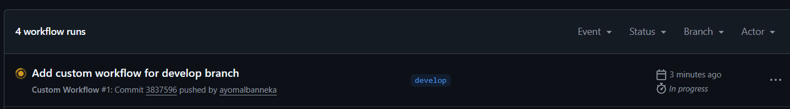
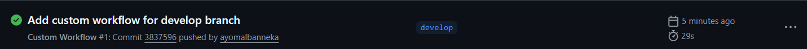
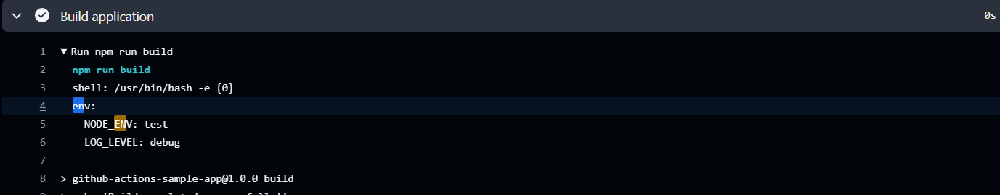
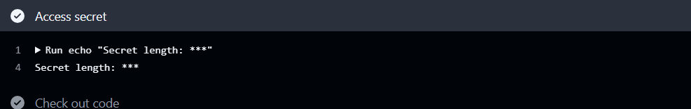
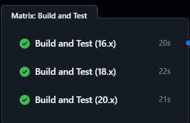

# Intermediate Badge Submission - Ayomal Banneka

**Date:** January 2026
**Status:** Submitted for Review

## Tasks Completed

- [x] Task 4: Custom workflow running on develop branch ✅
- [x] Task 5: Environment variables displaying in logs ✅
- [x] Task 6: GitHub secrets access (masked in logs) ✅
- [x] Task 7: Matrix testing across 3 Node versions in parallel ✅

## Evidence

### Task 4: Custom workflow running on develop branch ✅

### Task 5: Environment variables displaying in logs ✅

### Task 6: GitHub secrets access (masked in logs) ✅

### Task 7: Matrix testing across 3 Node versions in parallel ✅

## Notes
Any challenges faced or additional context.

---

Submitted & ready for review! ✅